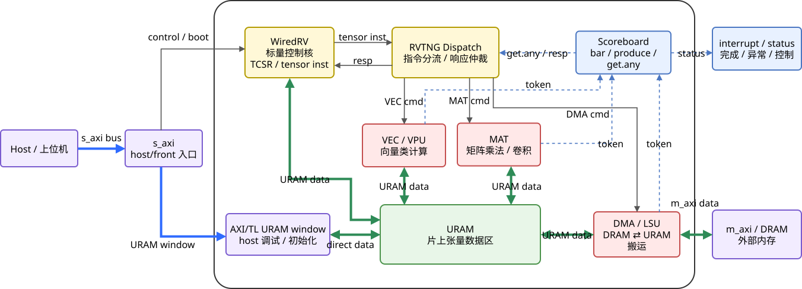

# 大衍

大衍（Dayan）是一款使用 [Chisel](https://www.chisel-lang.org/) 构建的开源 NPU（神经网络处理器）。本仓库是大衍 NPU 的 SoC 集成：将 RISC-V 标量核与 Dayan 张量核（矩阵 / 向量 / DMA）通过基于 AXI 的片上互联连接在一起。

English Readme is [here](readme.md).

©2026 中国科学院计算技术研究所版权所有

大衍基于[木兰宽松许可证第 2 版](http://license.coscl.org.cn/MulanPSL2)（Mulan PSL v2）开源，完整许可证文本见 [LICENSE](LICENSE)。

## 处理器架构

大衍是一款异构 NPU。每个 Dayan NPU 核由一个标量核（负责控制流与指令发射）和一个张量核（负责矩阵、向量与 DMA 计算）组成。SoC 对外提供一个前向（slave）AXI 端口供主机下发任务，以及一个主（master）AXI 端口访问外部存储；片上系统总线在各个核、控制块与外部世界之间路由数据。

大衍 SoC 微架构概览：


更多文档请见 [Dayan-Doc](https://github.com/OpenDayan/Dayan-Doc) 仓库。

## 目录概览

以下是一些关键目录：

```
.
├── src
│   ├── main/scala         # 设计文件
│   │   └── rvtsoc
│   │       ├── blackbox   # 当子模块缺失时使用的空桩实现
│   │       ├── config     # CDE 配置
│   │       ├── devices    # 用于仿真的 AXI DPI 等辅助设备
│   │       ├── subsystem  # NPU 核、控制块与系统总线
│   │       ├── top        # 顶层模块（Rvtsoc）与仿真封装
│   │       └── utils      # 复用封装
│   ├── main/csrc          # 仿真框架的 C/C++ 源码
│   └── main/resources     # 启动 ROM 及其他资源
├── sim                    # 基于 Verilator 的协同仿真环境
│   ├── src                # 仿真器宿主代码、ELF 加载器、DPI 设备
│   └── third_party        # spdlog、dotenv-cpp
├── scripts                # 用于敏捷开发的脚本
├── deps                   # git 子模块（rocket-chip、AxiInfra 等）
└── build.mill             # mill 构建定义
```

## 更新依赖

大衍依赖若干 git 子模块（如 `rocket-chip`、`AxiInfra`、`WiredRV`、张量核 `rvt` 以及 `difftest`）。克隆本仓库后，请递归地初始化并更新它们：

```bash
make deps
```

`scripts/update-submodules.py` 还会递归进入每个依赖自身的嵌套子模块。

## 生成 Verilog

* 运行 `make`（默认目标为 `verilog`）以生成用于仿真的 SystemVerilog 代码，输出位于 `generated/${VERILOG_TOP}-${CONFIG}/`，即 `generated/TestRvtsoc-VerifRvtsocConfig/`。其中的封装子模块（时序 RAM、`EICG_wrapper`）会被移动到 `wrappers/` 子目录，生成元数据（`config.txt`、`version.txt`，以及启用时可获得的 `mem.conf`）写入 `generated/<top>-<config>/info/`。
* 可用的 `CONFIG` / 顶层模块选项详见 `makefile` 与 `build.mill`。`make verilog` 会传入 `-D abs-path=true` 使生成的 filelist 使用绝对路径。
* 运行 `make verilog-fpga` 以生成 FPGA 使用的 `RvtsocWrapper` 顶层，它会关闭验证逻辑（`-D dis-verif=true`），输出位于 `generated/RvtsocWrapper-RvtsocConfig/`。

## 仿真运行

### 环境搭建

* 项目使用 `mill` 进行编译，因此需要安装 `mill`，详见 [mill 安装指南](https://mill-build.org/)。
* 克隆本项目，运行 `make deps` 以初始化本仓库引用的子模块。
* 安装开源 verilog 仿真器 [Verilator](https://verilator.org/guide/latest/)。若不在默认路径下，请设置 `VERILATOR_ROOT` 环境变量。
* 仿真器还依赖 `cmake`、`clang`/`clang++`，以及系统库 `fuse3`、`libzstd` 与 `zlib`。

### 运行仿真

* 运行 `make sim-config` 以通过 CMake 配置仿真构建。常用覆盖参数（定义于 `makefile`）：

  | 变量               | 默认值           | 说明                                |
  | ------------------ | ---------------- | ----------------------------------- |
  | `CONFIG`           | `VerifRvtsocConfig` | 用于生成 RTL 的 CDE 配置         |
  | `SIM_C_COMPILER`   | `clang`          | 仿真框架使用的 C 编译器            |
  | `SIM_CXX_COMPILER` | `clang++`        | 仿真框架使用的 C++ 编译器          |
  | `SIM_THREADS`      | `16`             | 传入 Verilator 的线程数            |
  | `SIM_TRACE_FST`    | `ON`             | 是否开启 FST 波形                  |
  | `SIM_TOP_NAME`     | `TestRvtsoc`     | 待仿真的顶层模块                   |
  | `SIM_CONFIG`       | `VerifRvtsocConfig` | 传给 CMake 的 CDE 配置，需与 `CONFIG` 一致以保证从 `generated/<top>-<config>/` 加载 RTL |

* 运行 `make sim -j` 构建并运行仿真器。
* 编译产物为 `sim/build/TestRvtsoc`，波形文件输出到 `sim/logs/*.fst`。请将 `SIM_CONFIG` 设为生成 RTL 所用的配置（默认 `VerifRvtsocConfig`），以便 CMake 找到生成的 RTL。

运行示例：

```bash
make sim-config
make sim -j
```

## 开发

### 为仿真添加额外的源文件与包含路径

可在 Scala 中通过 `ExtraFiles` 向生成的仿真附加额外的 C/C++ 源文件与包含路径：

```scala
import dayan.rvtsoc.utils.ExtraFiles
ExtraFiles.add("test.sv") // test.sv
ExtraFiles.add("test.c") // test.c
ExtraFiles.addResource("/rvtsoc/test.c") // src/main/resources/rvtsoc/test.c
ExtraFiles.addIncludePath("include") // include
ExtraFiles.addResourceIncludePath("/rvtsoc") // src/main/resources/rvtsoc
```

## 许可证

本仓库基于木兰宽松许可证第 2 版（Mulan PSL v2）开源（见 [LICENSE](LICENSE)）。独立的 `license-header.txt` 仅用于添加到每个 Scala 源文件头部的声明片段，并非许可证本身。可按如下方式校验或补充源码许可证头：

```bash
./mill __.license.check    # 校验所有 Scala 文件是否带有许可证头
./mill __.license.create   # 为缺失许可证头的文件补充
```
